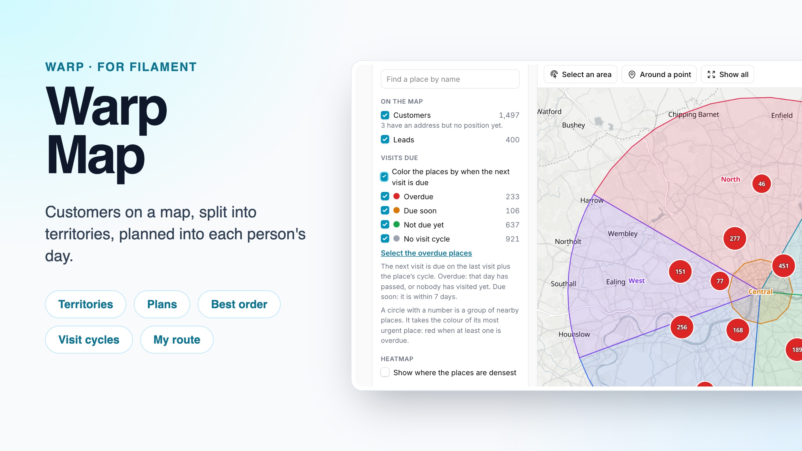
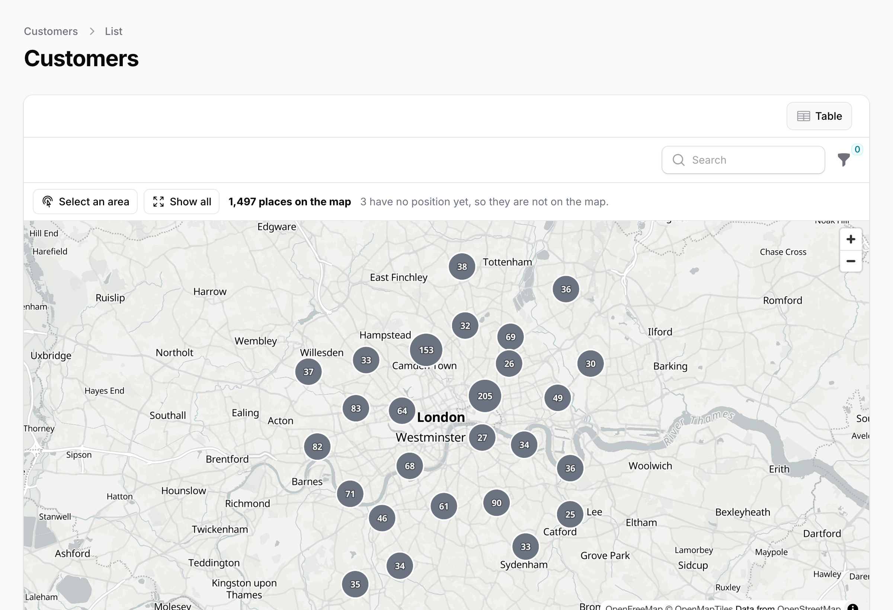
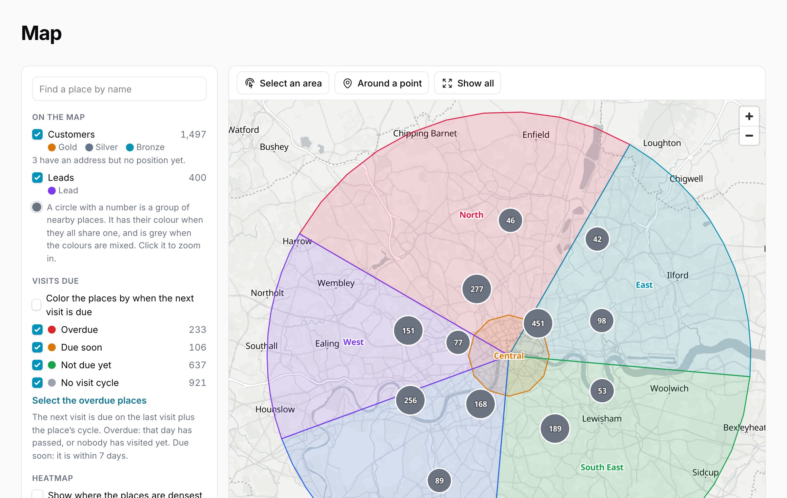
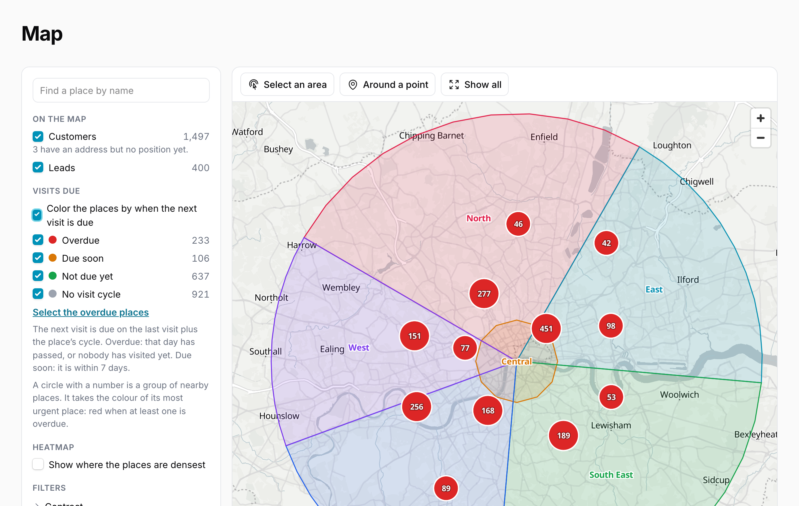
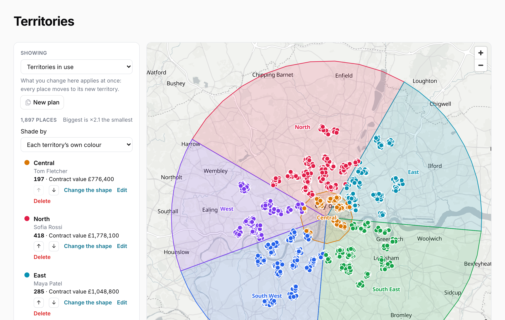
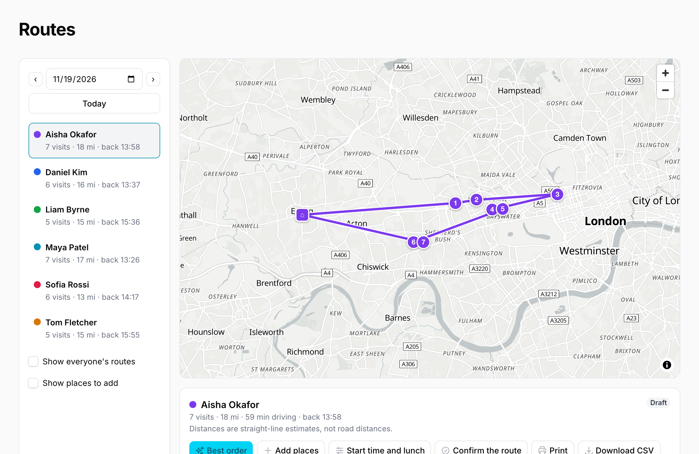
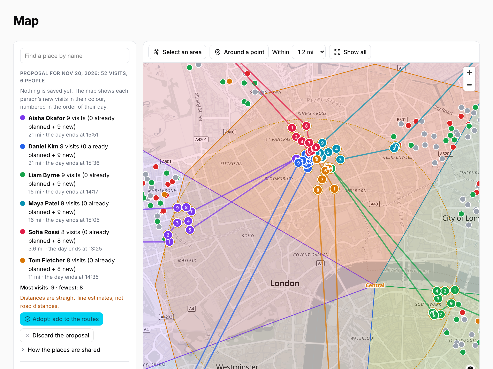
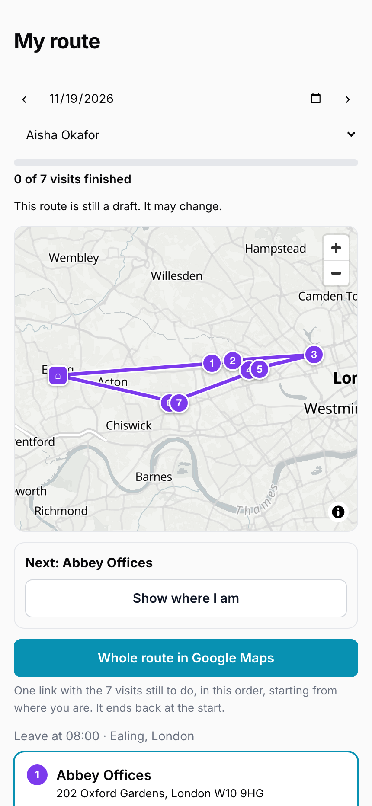

# Warp Map

**Territories and route planning for Filament. Put your customers, sites and leads on a fast map, split them into territories by drawing or by postal code, try a new split as a plan and compare it before you use it, and plan each person's day in the best order — with arrival times, opening hours and a lunch break. Works on its own; adds travel time and day ordering to Warp Scheduler when you have it.**

<a href="https://demo.warpui.com/map"></a>

Draw around a group of customers and add them to a technician's day, put the day in the best order, compare two ways of splitting London into territories, then open the technician's route on your phone — at **[demo.warpui.com/map](https://demo.warpui.com/map)**. No sign-up needed; the data is reset every hour.



- [What it does](#what-it-does)
- [Installation](#installation)
  - [AI coding assistants (Laravel Boost)](#ai-coding-assistants-laravel-boost)
- [Quick start](#quick-start)
- [The pages and their URLs](#the-pages-and-their-urls)
- [Your models on the map](#your-models-on-the-map)
- [A map for any table](#a-map-for-any-table)
- [The map page](#the-map-page)
- [Visits due: color the places by their visit cycle](#visits-due-color-the-places-by-their-visit-cycle)
- [Territories](#territories)
- [Plans: try a new split before you use it](#plans-try-a-new-split-before-you-use-it)
- [Routes](#routes)
- [How the best order is worked out](#how-the-best-order-is-worked-out)
- [Share visits between several people](#share-visits-between-several-people)
- [My route (on a phone)](#my-route-on-a-phone)
- [Road distances: OSRM or Google](#road-distances-osrm-or-google)
- [Finding positions from addresses](#finding-positions-from-addresses)
- [Map tiles](#map-tiles)
- [In your own forms, pages and tables](#in-your-own-forms-pages-and-tables)
- [An area field: draw a polygon or a circle](#an-area-field-draw-a-polygon-or-a-circle)
- [With Warp Scheduler](#with-warp-scheduler)
- [With Warp Offline](#with-warp-offline)
- [Who can do what](#who-can-do-what)
- [Plugin options](#plugin-options)
- [Multi-tenancy](#multi-tenancy)
- [Commands](#commands)
- [Requirements](#requirements)

## What it does

- **A map of your own records.** Customers, sites, assets or leads — any Eloquent model — on one map, colored by a field you choose, with clusters for thousands of places, filters, and a search by name. A cluster takes the color of its places when they all share one, and is grey when the colors are mixed.
- **A map for any table.** One line on a list page or a relation manager adds a **Table / Map** button: the rows become a map of the same records, and the table's own search, filters and tabs decide what is on it. You don't need territories or routes to use it.
- **Heatmap and shaded territories.** One checkbox turns the map into a heatmap of your places — by their number or weighted by a measure such as revenue — and the territories can be shaded by how many places or how much revenue each one holds.
- **Select by drawing.** Hold the mouse button down and draw around places, or pick everything within a distance of a point. Add the selection to someone's route, put it in a territory, download it as CSV, or run your own action on it.
- **Visits due.** Give each place a visit cycle ("every 30 days"). The map colors the places by when the next visit is due — red for overdue, amber for due soon — and selects every overdue place in one click, ready to add to a route.
- **An area field for your own forms.** `AreaField` draws a polygon or a circle on a map and saves it in a JSON column of your model — a delivery area, a geofence, a building site — and `Area` answers "is this point inside?".
- **Territories.** Draw an area on the map, list postal codes, or import the boundaries you already have from a GeoJSON or KML file. Every place belongs to the first territory that covers it, and moves by itself when you change a shape or the place's address. Give each territory an owner and see its number of places and totals (revenue, contract value…).
- **Plans.** Copy your territories into a plan, or let Warp Map split your places into *N* territories with about the same number of places (or the same revenue). Compare the plans side by side, then adopt one.
- **Routes.** Pick a date and a person, add visits, and press **Best order**. Opening hours, the time spent at each place, a lunch break and the drive home are respected. Drag a visit to change the order — the times update at once. No limit of 10 or 20 stops.
- **Share visits between people.** Select 40 places, tick three people: each gets about the same number, close to home, with the day already in the best order. You see it as a proposal on the map and adopt it — or not.
- **Who is nearest?** For any place, see the people closest to it — from their home, or from their visits that day.
- **My route.** Each person sees today's visits on their phone, opens directions in Google Maps or Apple Maps — one visit or the whole rest of the day — records when (and, if they allow it, where) they arrived, and marks visits as done or skipped, with a note.
- **Works without any API key.** Distances start as straight-line estimates. Connect OSRM (free, on your own server) or Google for road distances when you need them.

## Installation

> **Warp Map is a commercial plugin.** A license is required. After purchase you receive credentials for the private Composer repository.

```bash
composer config repositories.qalainau composer https://qalainau.privato.pub/composer
composer config --auth http-basic.qalainau.privato.pub "your-email" "your-license-key"

composer require qalainau/filament-warp-map
php artisan migrate
php artisan filament:assets
```

The migrations create the plugin's own tables (`warp_map_*`): territories, plans, routes and visits, and a list of addresses already looked up. Your tables are not changed. To edit the migrations, publish them with `php artisan vendor:publish --tag=filament-warp-map-migrations` before you run `php artisan migrate` the first time.

> Run `php artisan filament:assets` again after every update of the package.

### AI coding assistants (Laravel Boost)

Warp Map ships instructions for AI coding assistants such as Claude Code, Cursor and Codex. If your app uses
[Laravel Boost](https://laravel.com/docs/boost), the assistant learns how to use Warp Map from them: how to
register places and people, configure maps and routes, handle units, permissions and tenancy, and test
territories and route planning.

- **Guidelines** (`resources/boost/guidelines/core.md`): a short summary that Boost adds to `CLAUDE.md`,
  `AGENTS.md` and the other agent files. It also points the assistant to this README in `vendor/`, so it reads the
  documentation of the version you have installed instead of guessing.
- **Skill** `warp-map-development` (`resources/boost/skills/`): the steps for registration, model locations, table
  maps, geocoding, territories, routes, tenancy and feature tests. The assistant loads it when it works on maps and route planning.

Boost does not add guidelines of other vendors' packages on its own. When `php artisan boost:install` asks
"Which third-party AI guidelines/skills would you like to install?", select `qalainau/filament-warp-map`. To do
it without the question, add the package to `boost.json` and run the command again:

```json
{
    "packages": ["qalainau/filament-warp-map"]
}
```

```bash
php artisan boost:install --guidelines --skills -n
```

## Quick start

1. Add `HasLocation` to a model that has a latitude and a longitude (or an address):

```php
use Qalainau\FilamentWarpMap\Concerns\HasLocation;
use Qalainau\FilamentWarpMap\MapLocation;

class Customer extends Model
{
    use HasLocation;

    public static function mapLocation(): MapLocation
    {
        return MapLocation::make()
            ->latitude('lat')
            ->longitude('lng')
            ->address(fn (Customer $customer) => "{$customer->street}, {$customer->city} {$customer->postcode}", ['street', 'city', 'postcode'])
            ->postalCode('postcode')
            ->title('name');
    }
}
```

2. Add the plugin to your panel:

```php
use Qalainau\FilamentWarpMap\FilamentWarpMapPlugin;

$panel->plugin(
    FilamentWarpMapPlugin::make()
        ->locations([Customer::class])
        ->people(Technician::class, title: 'name', home: fn (Technician $technician) => [$technician->home_lat, $technician->home_lng, $technician->home_address])
);
```

3. Open **Map**. Customers with a latitude and longitude are on it. Customers with only an address get their position in the background (see [Finding positions from addresses](#finding-positions-from-addresses)); run `php artisan warp-map:geocode` once for the ones you already have.

`people()` is needed for routes and territory owners. Without it, you still get the map and territories.

## The pages and their URLs

The plugin adds up to four pages to the panel. The URLs are relative to the panel's path (`/admin` below); in a panel with [multi-tenancy](#multi-tenancy), the tenant comes first, as in any Filament page.

| Page | URL | With tenancy | Query string | Who sees it |
| --- | --- | --- | --- | --- |
| **Map** | `/admin/map` | `/admin/{tenant}/map` | — | Everyone who passes `canAccess()`. |
| **Territories** | `/admin/map/territories` | `/admin/{tenant}/map/territories` | `?plan=3` opens a plan instead of the territories in use | Everyone who passes `canAccess()`; changing them needs `canManageTerritories()`. Not added with `territories(false)`. |
| **Routes** | `/admin/map/routes` | `/admin/{tenant}/map/routes` | `?date=2026-11-05&person=3` opens that day and that person | People who pass `canPlanRoutes()`. Not added with `routes(false)`. |
| **My route** | `/admin/map/my-route` | `/admin/{tenant}/map/my-route` | `?date=2026-11-05`; people who pass `canPlanRoutes()` can add `&person=3` to see someone else's route | People found by `personForUser()`, and people who pass `canPlanRoutes()`. Not added with `routes(false)`. |

`{tenant}` is the tenant's key, or its `slugAttribute` when the panel sets one. To link to a page from your own code, use the page class rather than writing the URL: it adds the panel path and the current tenant for you.

```php
use Qalainau\FilamentWarpMap\Pages\MapPage;
use Qalainau\FilamentWarpMap\Pages\MyRoute;
use Qalainau\FilamentWarpMap\Pages\Routes;
use Qalainau\FilamentWarpMap\Pages\Territories;

MapPage::getUrl();                                                         // /admin/map
Routes::getUrl(['date' => '2026-11-05', 'person' => $technician->id]);    // /admin/map/routes?date=2026-11-05&person=3
MyRoute::getUrl();                                                         // /admin/map/my-route
Territories::getUrl(['plan' => $plan->id]);                               // /admin/map/territories?plan=3
```

## Your models on the map

Every option of `MapLocation`:

```php
MapLocation::make()
    ->label('Customer', 'Customers')        // the name in the legend and filters
    ->latitude('lat')->longitude('lng')    // your columns (decimal)
    ->address('full_address')              // a column, or a closure with the columns it reads:
    ->address(fn (Customer $c) => "{$c->street}, {$c->city}", ['street', 'city'])
    ->postalCode('postcode')               // for postal-code territories and the automatic split
    ->title('name')                        // a column or fn (Customer $c) => …
    ->subtitle(fn (Customer $c) => ucfirst($c->tier).' contract')
    ->color(fn (Customer $c) => $c->tier === 'gold' ? '#d97706' : '#0891b2', ['#d97706' => 'Gold', '#0891b2' => 'Other'])
    ->visitMinutes(fn (Customer $c) => $c->service_minutes)   // time spent there, default 30
    ->visitWindow(fn (Customer $c) => $c->opens_at ? [$c->opens_at, $c->closes_at] : null)  // ['09:00', '12:00'] or null
    ->visitEvery('visit_every_days', soon: 7)  // the visit cycle in days; see "Visits due"
    ->lastVisitedAt('last_serviced_at')        // optional: your own column for the last visit (or lastVisitsUsing(), see "Visits due")
    ->measure('revenue', 'annual_revenue', 'Revenue', '£')     // summed per territory; also usable to balance the split
    ->url(fn (Customer $c) => CustomerResource::getUrl('view', ['record' => $c]))  // "Open" in the map popup
    ->query(fn (Builder $query) => $query->where('active', true))  // which records belong on the map
    ->searchable(['name', 'postcode'])     // columns searched in "Add places" on the routes page
    ->geocodeOnSave(true)                  // default; see below
    ->tenantRelationship('team');          // see Multi-tenancy
```

- **Colors** can be `#rrggbb`, `#rgb`, `rgb(…)`, Filament color names (`primary`, `warning`) or Tailwind names (`amber`, `sky`). The legend is optional.
- **Closures** receive the record by the name `$record` or by type (`fn (Customer $customer) => …`), like Filament's own closures.
- **Several models** can be on the same map: `->locations([Customer::class, Site::class, Lead::class])`. Each gets its own layer and checkbox.
- **What happens when you save a record:** if its address changed and its position did not, the position is looked up again in the queue. If its position or postal code changed, its territory is worked out again. Deleting a record removes it from its territory; visits already in routes keep their name and address.

## A map for any table

The quickest way to use Warp Map: add a **Table / Map** button to a table you already have. It needs only step 1 of the quick start (the model uses `HasLocation`) — no territories, no routes, no `locations()`.



```php
use Filament\Resources\Pages\ListRecords;
use Qalainau\FilamentWarpMap\Tables\Concerns\HasMapView;

class ListCustomers extends ListRecords
{
    use HasMapView;

    protected static string $resource = CustomerResource::class;
}
```

Press **Map** in the table's header and the rows are replaced by a map; **Table** brings them back. The search field, the filters and the tabs stay where they are, above the map.

- **The table decides what is on the map.** The map shows the records that pass the table's search, filters and active tab — from every page, not only the 10 on screen. Change a filter and the map follows. It reads the table's own query, so your resource's permissions, `getEloquentQuery()` and the tenant apply to the map exactly as they do to the rows.
- **Colors, titles and the legend** come from the model's `mapLocation()` (`color()`, `title()`, `subtitle()`, `measure()`).
- **Click a place** to see its name, address and totals. **Open** goes to `MapLocation::url()`; without it, on a resource's list page, to the record's view page (or edit page) when the user may open it.
- **Select an area** appears when the table has bulk actions: draw around places and they become the table's selected records, so every bulk action — yours, or `AddToRouteBulkAction` — works from the map. The bubble of a single place has **Select** / **Deselect** too.
- **Records without a position** are not on the map; the bar above it says how many.
- On a list page the URL keeps the choice (`?view=map`), so you can link straight to the map.

It works the same in a **relation manager** (the map shows that owner's records), a table widget, or any Livewire component with a Filament table:

```php
class SitesRelationManager extends RelationManager
{
    use HasMapView;

    protected static string $relationship = 'sites';
}
```

Three methods can be overridden in the class that uses the trait:

| Method | Default | What it does |
| --- | --- | --- |
| `showsMapViewFirst(): bool` | `false` | Return `true` to open on the map instead of the rows. |
| `getMapViewHeight(): string` | `'34rem'` | The height of the map (any CSS length; it never exceeds 80% of the window). |
| `getMapViewLocation(Model $model): MapLocation` | the model's `mapLocation()` | How the records are shown. Return your own `MapLocation` to use other columns, colors or titles in this table only. |

Notes:

- The model must use `HasLocation`; otherwise the map says which model is missing it.
- The map shows up to `maxPoints()` places (50,000 by default) and says so when there are more.
- The latitude and longitude must be columns of the table's own model (not of a related model).
- If you set the table's `content()` yourself (a grid of cards), it is still used for the rows; the map replaces it only while **Map** is on.
- The trait adds the public property `$warpMapView` and the methods `mapViewPoints()`, `mapViewDetails()`, `toggleMapView()` and `isMapView()` to your component; avoid these names for your own members.

## The map page

**Map** shows every place with a position. Close to each other, places are grouped in a circle with their number; click it to zoom in. Click a single place to see its name, address, territory and owner, and the totals from `measure()`.



- **On the map** — turn each kind of place on and off. The legend comes from `color()`. Places with an address but no position yet are counted here.
- **Filters** — your own, see below.
- **Territories** — show or hide the shapes, and show only the places in some territories (or in none).
- **Find a place by name** — searches the names of the places on the map, as you type.
- **Select an area** — draw around places with the mouse (or a finger). Draw again to add more.
- **Around a point** — click the map to select everything within a distance (500 m to 25 km, or miles).

With places selected, you can **add them to a route** (pick a date and a person), **put them in a territory**, **download them as CSV**, or run an action of your own:

```php
use Qalainau\FilamentWarpMap\Actions\SelectionAction;
use Qalainau\FilamentWarpMap\MapFilter;

FilamentWarpMapPlugin::make()
    ->filters([
        MapFilter::make('tier')
            ->label('Contract')
            ->options(['gold' => 'Gold', 'silver' => 'Silver', 'bronze' => 'Bronze'])
            ->for(Customer::class),                                  // only for this kind of place
        MapFilter::make('overdue')
            ->options(['yes' => 'Service overdue'])
            ->query(fn (Builder $query, array $values) => $query->where('next_service_at', '<', now())),
    ])
    ->selectionActions([
        SelectionAction::make('call-list')
            ->label('Add to the call list')
            ->requiresConfirmation()
            ->action(fn (Collection $records) => CallList::add($records) ? "{$records->count()} added." : null),
    ]);
```

The filter options and the value you get in `query()` are the keys of `options()`; values that are not in `options()` are ignored. `SelectionAction` receives the selected models (of every kind); the string it returns is shown when it is done.

**Heatmap.** Tick **Show where the places are densest** and the grouped circles give way to a heatmap: blue where there are few places, red where there are many. It follows everything else on the page — the kinds of places you turned off, your filters, the territories and the visit states you unticked — so "where are my gold customers?" is one filter and one checkbox. Zoom in (to about street level) and the places themselves appear, ready to be clicked.

With `measure()` on a model, **Weight by** lists your measures next to *Number of places*: choose *Revenue* and the red moves to where the money is. A place counts as its value divided by the average value of the places shown, so the map is as bright as the plain one, just distributed differently; one giant customer counts at most four times the average and cannot paint the whole map. The choice is remembered in the browser. The heatmap needs nothing set up: it is drawn by MapLibre from the places already on the map.

The map shows up to 50,000 places at once (`->maxPoints()`). When there are more, it says so; use the filters to see the rest.

## Visits due: color the places by their visit cycle

For route sales, regular maintenance and inspections: tell Warp Map how often each place should be visited, and the map shows who is overdue.



```php
MapLocation::make()
    ->visitEvery('visit_every_days')                     // a column with the number of days
    ->visitEvery(30)                                     // or the same cycle for every record
    ->visitEvery(fn (Customer $c) => $c->tier === 'gold' ? 30 : 90, soon: 14);   // or a closure; "due soon" starts 14 days before
```

The next visit is due on **the last visit + the cycle**. A record whose cycle is `null` or `0` has no cycle and is left out.

- **Overdue** (red): the day has passed, or nobody has visited the place yet.
- **Due soon** (amber): the day is within `soon` days (7 by default), today included.
- **Not due yet** (green).

**Where the last visit comes from.** By default it is the last time the place was marked **Done** in a Warp Map route (on **My route**), so the colors follow the work without any code: mark a visit as done and the place turns green; **Undo** turns it back. If you keep the date yourself, name it:

```php
->lastVisitedAt('last_serviced_at')                                   // a date or datetime column
->lastVisitedAt(fn (Customer $c) => $c->jobs()->max('finished_at'))    // or a closure (called once per record)
```

With `lastVisitedAt()` or `lastVisitsUsing()` (below), the routes are not looked at.

**Many places? Read the last visits in one query.** A `lastVisitedAt()` closure runs once per place, so a map of 3,000 sites runs 3,000 queries. When the last visit lives in your own records — the last completed work order, the last delivery, the last inspection — use `lastVisitsUsing()` instead. It receives the places being read as an Eloquent collection and returns `[key => date]`:

```php
use Illuminate\Database\Eloquent\Collection;

MapLocation::make()
    ->visitEvery('visit_every_days')
    ->lastVisitsUsing(fn (Collection $records) => WorkOrder::query()
        ->whereIn('site_id', $records->modelKeys())
        ->where('status', 'completed')
        ->groupBy('site_id')
        ->selectRaw('site_id, max(completed_at) as at')
        ->pluck('at', 'site_id'));
```

- **Arguments:** `$records` — the places being read (an `Illuminate\Database\Eloquent\Collection` of your model). They are already limited to the current tenant and to `query()`, and places without a visit cycle are left out. Name the parameter `$records`, type it as a `Collection`, or leave it untyped.
- **Return:** an array or a collection keyed by the model's key. A value can be a `Carbon` / `DateTime`, a date string (read in `app.timezone`, like Laravel's timestamps) or `null`. A place whose key is missing, or whose value is `null`, has **never been visited** (overdue). Keys of places that were not passed in are ignored.
- **How often it is called:** once per read — once for the map (once per 2,000 places on very large maps), once per page of a table with `VisitDueColumn`, and once (with one record) for the bubble of a place and `mapVisitDue()`.
- **With both:** if a location has `lastVisitsUsing()` and `lastVisitedAt()`, `lastVisitsUsing()` is used and `lastVisitedAt()` is ignored.
- Limit your own query to the current tenant if the records you read are not already limited (for example by a global scope): `whereIn(... $records->modelKeys())` keeps it to the places on the map, which is usually enough.

**On the map page**, a **Visits due** section appears when a model on the map has `visitEvery()`:

- **Color the places by when the next visit is due** switches the colors of the places from `color()` to red / amber / green (grey for places without a cycle). A circle that groups nearby places takes the color of its most urgent place, so a red circle always hides at least one overdue place.
- Each state has a checkbox and its number of places. Untick **Not due yet** and **No visit cycle** to keep only what needs a visit.
- **Select the overdue places** selects every overdue place that is shown. Use the filters, the territories or **Select an area** first to narrow it down, then **Add to a route**.
- The bubble of a place shows its cycle, the last visit, the day the next one is due and how late it is.

**In a table**, `VisitDueColumn` shows the same as a badge ("12 days late", "Due in 3 days", "Never visited"), with the last visit and the due date in its tooltip:

```php
use Qalainau\FilamentWarpMap\Tables\Columns\VisitDueColumn;

VisitDueColumn::make(),
```

**In your own code:**

```php
$customer->mapVisitDue();
// ['status' => 'overdue', 'every' => 30, 'last' => CarbonImmutable, 'due' => CarbonImmutable, 'late' => 12]
// status: ok, soon or overdue. late: days after the due date (negative = days left, null = never visited).
// null when the record has no cycle.
```

Notes:

- Days are counted in the panel's time zone (`FilamentTimezone`), so a visit finished at 01:00 counts for that day, not the day before in UTC.
- Skipped visits do not count as a visit.
- `VisitDueColumn` reads the last visits of the whole table page in one query (from the routes or `lastVisitsUsing()`); with a `lastVisitedAt()` closure, the closure still runs once per row. `mapVisitDue()` reads one record. The column cannot be sorted or searched; to sort by the due date, keep it in a column of your own.
- The map works the states out for every place in one query per model (with `lastVisitsUsing()`: one call per model, or per 2,000 places).

## Territories

**Territories** lists the territories in their order, with the owner, the number of places and the totals. The map colors each place with the color of its territory.



- **New territory** asks for a name, a color, an owner and how to decide what is inside:
  - **Draw the area on the map.** Click the map to place each corner; click the first corner again (or double-click) to close the shape, then **Save the shape**. To change it later, press **Change the shape**: drag a corner, click the small dot between two corners to add one, Alt-click or right-click a corner to remove it.
  - **List postal codes.** Each value takes every postal code that starts with it: `100` takes `100-0001` and `1000005`, `606` takes `60601`. When a postal code has a space (UK), a value as short as the part before the space must match that part exactly: `SW1` takes `SW1 1AA` but not `SW11 4AB` or `SW1A 1AA`; write `SW1A` or `SW11` for those.
- **Order matters.** A place inside two territories belongs to the one higher in the list. Use the arrows to move a territory up or down. A small "Central" territory above a big "North" one works as expected.
- **Put places in a territory by hand** — from the map selection, or with the bulk action in your table. Places put in by hand stay there when you redraw the shapes. Choose "Decide by the shapes" to undo it.
- **Places outside every territory** are counted; tick the box to see only them.
- **Biggest is ×1.4 the smallest** — the number of places in the busiest territory compared with the quietest. The closer to ×1, the fairer the split.

- **Import shapes** creates territories from a boundary file you already have (see [Import boundaries](#import-boundaries-geojson-and-kml) below).
- **Shade by** colors the territories by a number instead of their own colors: the number of places, or one of your `measure()`s (revenue, contract value…). The darker a territory, the higher its number; the scale above the list shows the smallest and the biggest, each name on the map gets its number under it, and the places turn grey so the shades stand out. It works for the territories in use and for a plan, so you can see at a glance whether a new split is fairer. Choose **Each territory's own colour** to go back.

When you change the territories in use, every place moves to its new territory at once. Your own code can read the territory of a record with `$customer->mapTerritory()` (a `Territory` model, or `null`), and the relation `mapAssignment.territory` works in tables:

```php
TextColumn::make('mapAssignment.territory.name')->label('Territory'),
```

### Import boundaries (GeoJSON and KML)

If your areas already exist somewhere — sales regions from a GIS tool, postcode districts, a map drawn in Google My Maps or Google Earth — press **Import shapes** on the territories page and choose the file. Every polygon becomes a territory, named after its `name` (GeoJSON: the `name`, `NAME`, `title` or `label` property; KML: the placemark's `<name>`), with a color of its own. Territories without a name are called "Imported 1", "Imported 2"…, and a name that already exists gets "(2)".

- **GeoJSON** (`.geojson`, `.json`): a `FeatureCollection`, a single `Feature`, a `GeometryCollection` or a bare geometry. `Polygon` and `MultiPolygon` are read, holes included.
- **KML** (`.kml`): the polygons of every `<Placemark>`, also inside `<MultiGeometry>` and folders, holes included. A **KMZ** file is a zipped KML: unzip it and upload the `.kml` inside.
- Lines and points are skipped; the message after the import says how many.

**Where they go.** The default is **a new plan**: nothing changes until you look at it, compare it with the territories in use and adopt it. You can also add the shapes to the plan you are looking at, or straight to the territories in use (every place then moves to its new territory at once).

**The file is not trusted.** It is read on the server and thrown away; nothing of it is stored but the shapes and their names.

| Limit | Value |
| --- | --- |
| File size | 2 MB |
| Shapes in one file | 200 |
| Points in one file | 50,000 |

- Every coordinate must be a number on the earth; a shape with a point that is not is left out. Names are kept as plain text of one line, 120 characters at most.
- A KML file with a `<!DOCTYPE>` or `<!ENTITY>` declaration is refused, so a file cannot make the server read its own files or expand itself until the memory is full.
- A file over a limit is refused with a message that says which one. For detailed boundaries (a coastline has tens of thousands of points), simplify them first, for example with [mapshaper.org](https://mapshaper.org) — territories do not need that detail.
- Only people who may manage territories (`canManageTerritories()`) see the button, and with multi-tenancy the territories are created in the current tenant.

To read a file in your own code — an import command, a seeder:

```php
use Qalainau\FilamentWarpMap\Domain\BoundaryImport;
use Qalainau\FilamentWarpMap\Domain\BoundaryImportException;

try {
    $result = (new BoundaryImport)->parse(file_get_contents($path), 'geojson');   // or 'kml'
} catch (BoundaryImportException $exception) {
    report($exception->label());   // "The file has no polygons…"
}

foreach ($result['shapes'] as $shape) {
    Territory::query()->create(['name' => $shape['name'] ?? 'Area', 'mode' => Territory::POLYGON, 'geometry' => $shape['geometry']]);
}
// $result['skipped']: shapes that were not polygons
// new BoundaryImport(maxBytes: 10 * 1024 * 1024, maxShapes: 1000, maxPoints: 200000) raises the limits for your own files
```

After creating territories in use from your own code, run `php artisan warp-map:assign`.

## Plans: try a new split before you use it

**New plan** starts from:

- **a copy of the territories in use** — to try a small change,
- **an automatic split** — choose how many territories (usually one per person) and what should be about the same in each: the number of places, or one of your `measure()`s such as revenue,
- **nothing** — draw everything yourself.

A plan does not change anything until you adopt it. Switch between the territories in use and the plans with **Showing**; the map shows where each place would go in that plan.

**Compare plans** puts the territories in use and every plan side by side: the number of territories, *biggest vs. smallest* for places and for each measure, and the places that would be outside every territory.

**Adopt this plan** replaces the territories in use with the plan's territories, and every place moves at once. Places you had put in a territory by hand go back to following the shapes.

**How the automatic split works.** Places are grouped by postal district (the part before the space for UK codes, the first three digits of Japanese codes, the whole code otherwise), so a district is never cut in two. The districts are then split in two along the longer side (east–west or north–south) where the weights are equal, again and again until there are as many groups as you asked for. The result is a set of postal-code territories you can rename, give an owner, and fine-tune. Places without a postal code are grouped by position instead, and get a drawn shape.

## Routes

**Routes** shows the day's people on the left with their number of visits, the distance and the time they are back. Pick a person to see their route; the URL keeps the date and the person (`?date=2026-11-05&person=3`), so you can link to it.



- **Add places** searches all kinds of places by name. You can also turn on **Show places to add** and click places on the map, or add a selection from the map page.
- **Best order** works out the order with the least driving that still reaches every place in its opening hours (see the next section).
- **Drag** a visit up or down to change the order yourself. The times update right away.
- Each visit shows the arrival time, the time there, the opening hours, and a badge when the person has to **wait** for the place to open or arrives **too late**.
- **Start time and lunch**: when the person leaves home, whether they come back home at the end of the day, and when to take a lunch break and for how long. New routes start from the plugin's `workday()`.
- **Confirm the route** to stop changes; **Change the route again** to unlock it.
- **Print** prints a clean list with a box to tick per visit. **Download CSV** gives the same list.
- **Show everyone's routes** draws the other people's routes in their colors.

A route starts and ends at the person's home (from `people(home: …)`). If a person has no home, the route starts at the first visit. A visit keeps the name, address and position of the place when it was added, so old routes stay readable after the place changes or is deleted.

From your own code:

```php
use Qalainau\FilamentWarpMap\Domain\RoutePlanner;
use Qalainau\FilamentWarpMap\WarpMap;

$planner = new RoutePlanner(WarpMap::get());
$route = $planner->routeFor($technician, CarbonImmutable::parse('2026-11-05'));  // creates it if needed
$planner->addStops($route, Customer::query()->whereIn('id', $ids)->get());
$planner->optimize($route);

$route->stops;         // in order; arrive_at, depart_at, wait (minutes after midnight), late
$route->ends_at;       // when the person is back
$route->distance;      // metres
```

`$planner->nearestPeople($lat, $lng, $date)` returns the people nearest to a point, from their home or their visits that day — the same list as **Who is nearest?** in the map popup.

## How the best order is worked out

Warp Map solves the order itself, in PHP — no external service is needed:

1. It asks the routing service (or the straight-line estimate) for the driving time between every pair of places, the home and the end.
2. It builds two first orders — the visits with the earliest closing time first, and "always drive to the next place you can start soonest" — and improves each by reversing parts of the route (2-opt) and moving one, two or three visits elsewhere, until nothing gets better.
3. It keeps the better of the two. Being on time beats driving less: an order that reaches every place within its opening hours always wins over a shorter one that is late.

About 50 visits take a second or two. The same input always gives the same order. Visits marked as done or skipped stay first, in their order. The result is very good but not proven to be the best possible; you can always drag a visit.

## Share visits between several people

For the dispatcher's morning: a list of places to visit and several people to send. On the **Map** page, select the places (draw around them, pick everything around a point, or **Select the overdue places**) and press **Share between people** under the selection. Choose the date, tick the people (at least two), and press **Show the proposal**.



**A proposal first.** Nothing is saved. The panel lists each person with the number of visits ("18 visits (7 already planned + 11 new)"), the distance and the time the day ends, and badges when a visit would be too late or the day too long. The map shows each person's new visits in their color, numbered in the order of their day, with the line of the day. **Adopt: add to the routes** adds the visits to the routes of that date and puts each day in the best order — the distances and times are then exactly the ones the proposal showed. **Discard the proposal** drops it; your selection stays, so you can try other people or another date.

**How the places are shared** — a simple method you can explain to the team:

1. **Even numbers.** Everyone ends the day with about the same number of visits (they differ by one at most). Visits a person already has that day count, so someone with a full day gets fewer new ones, or none.
2. **Nearest first.** Each place goes to the person whose home — and, once they have places, the middle of their home and places — is nearest in a straight line. Places where the choice matters most (one person is much nearer than the next) are decided first.
3. **Swaps.** Two places swap people when that brings both closer.
4. **Best order.** Each person's day is ordered like **Best order** on the Routes page: opening hours, time at each place, lunch and the way home are respected.

Steps 1–3 use straight-line distances and no external service. Step 4 uses your `routing()`; without one, or when the service does not answer, it uses the straight-line estimate, and the proposal says so.

What is left out, and said in the proposal:

- places that are already in someone's route that day, and places without a position;
- people whose route that day is **confirmed** (reopen it on the Routes page to include them).

Notes:

- Up to 500 places in one go, and 200 visits in one route. A person without a home takes the group of places farthest from the others' homes.
- The split balances the **number** of visits, not their length. If a day comes out too long, the proposal shows the "too long" badge: tick more people or move visits on the Routes page afterwards.
- The same selection and the same people always give the same proposal.
- Only people who may plan routes (`canPlanRoutes()`) see the button. When adopting, the server checks every person and place again (tenant, permissions, still on the map, not planned meanwhile) instead of trusting what the browser sends back.

From your own code:

```php
use Qalainau\FilamentWarpMap\Domain\Distributor;

$distributor = new Distributor(WarpMap::get());

$proposal = $distributor->propose($customers, $technicians, CarbonImmutable::parse('2026-11-12'));   // saves nothing
// $proposal['people'][0]: name, before, added, total, distance, endsAt, late, tooLong, stops (key, title, lat, lng, order)

$distributor->adopt([
    ['person' => $maya, 'places' => $forMaya],     // collections of HasLocation models
    ['person' => $tom, 'places' => $forTom],
], CarbonImmutable::parse('2026-11-12'));           // ['added' => 23, 'people' => 2, 'routes' => [...]]

Distributor::assign($points, $homes, $loads);       // only the split: [[lat, lng], …], homes or null, visits already planned → place index => person index
```

## My route (on a phone)

**My route** shows the person's visits for today in order, with a map. For each visit:



- **Whole route in Google Maps** (above the list) opens every visit still to do as one Google Maps route: the visits are the waypoints, in the order of the list, and the route ends at home when the day does. It starts from where the person is. Finished and skipped visits are left out, so the link is always the rest of the day. Google Maps takes 10 places in one link; with more visits to do, the link has the next 10 and the line under the button says so — press it again when those are done.
- **Directions** opens Google Maps with the address as the destination; **Apple Maps** opens Apple Maps.
- **Arrived** records the time the person got there — and where they were at that moment, if their browser gives the position (see [Your position](#your-position-where-am-i-and-arrived) below).
- **Done** and **Skip** mark the visit (with the time); **Undo** takes it back.
- **Note** adds a note that the planner sees too.

These are plain links (`https://www.google.com/maps/dir/?api=1&…`): no Google API key is needed and nothing is sent to Google until the person presses one. The link carries the positions of the visits, not their names or addresses.

### Your position: "where am I" and "Arrived"

A card above the list names the next visit. Two things on the page use the browser's position (the Geolocation API):

- **Show where I am** puts a blue dot on the map, says how far the next visit is in a straight line, and adds **Directions from here**, a Google Maps link that starts at that position. Nothing is sent to your server: the position stays in the browser.
- **Arrived**, on each visit still to do, records the time on the server. If the browser gives a position, the latitude, longitude and accuracy (in metres) are recorded with it, and the visit shows "Arrived at 10:42 · 35 m from the address". The planner sees the same line on the **Routes** page. **Undo** clears the arrival together with the status.

**The position is recorded only when the person presses Arrived.** It is not tracked in the background, not read when the page opens, and not sent with **Done**, **Skip** or a note. The page says so under the list. Tell your staff, too: in many countries an employer must inform employees before recording where they are.

When the position is not available, nothing breaks:

- **The person (or their browser) refuses:** **Show where I am** explains how to allow it; **Arrived** records the time only and says "The arrival time is recorded, without a position".
- **The position is not found in 10 seconds, or the device has location turned off:** the same, with a message that says which.
- **The browser cannot give positions** (an old browser, or a page that is not served over https — browsers give positions only to secure pages): the **Show where I am** button is not shown, a line says why, and **Arrived** records the time.

To record the time but never ask for or store a position:

```php
FilamentWarpMapPlugin::make()->recordArrivalPosition(false)
```

The record is on the visit (`Qalainau\FilamentWarpMap\Models\Stop`): `arrived_at`, `arrived_lat`, `arrived_lng`, `arrived_accuracy`, and `$stop->arrivalDistance()` — the metres between that position and the visit. A position that is not on the earth is ignored (the time is still recorded). To keep the positions for a limited time only, clear the three columns in a scheduled command of your own.

The next visit is highlighted, and the bar shows how many are finished. Tell Warp Map who the logged-in user is with `personForUser()`:

```php
->personForUser(fn (User $user) => Technician::query()->where('user_id', $user->id)->first())
```

If the people model is your user model, you don't need it. People who can plan routes can also open anyone's route here (`?person=3`).

## Road distances: OSRM or Google

By default, distances are straight-line estimates: the straight distance × 1.3 for the bends in the road, at 30 km/h in town. Every feature works with it, and the screens say "Distances are straight-line estimates". For road distances:

```php
use Qalainau\FilamentWarpMap\Routing\Routing;

->routing(Routing::osrm('https://osrm.example.com'))           // your own OSRM server (free)
->routing(Routing::google(env('GOOGLE_MAPS_KEY')))              // Google Routes API (paid per request)
->routing(Routing::straightLine(speedKmh: 25, detour: 1.4))     // tune the estimate
```

- **OSRM** is free and open source. Run it on your own server with the map data of your region (`osrm-backend` has a Docker image; a city or a small country needs 1–4 GB of memory). The public demo server `router.project-osrm.org` must not be used for business. Tables larger than OSRM's `--max-table-size` (100 by default) are requested in pieces; pass `maxTable:` if you changed it.
- **Google** uses the Routes API (`computeRouteMatrix` and `computeRoutes`). Allow the Routes API on your key. Every new pair of places is a paid request; answers are cached for a week (`->cacheFor(minutes)`).
- **If the service does not answer**, Warp Map falls back to the straight-line estimate for that request, logs a warning, and the route says it is an estimate. Nothing breaks.
- **Your own service:** implement `Qalainau\FilamentWarpMap\Routing\RoutingDriver` (`matrix()`, `path()`, `followsRoads()`, `name()`) and pass it with `Routing::using(new MyDriver)`.

## Finding positions from addresses

When a record with `address()` is created without a position, or its address changes, Warp Map looks up the position in the queue (`GeocodeLocation` job, retried later if the service is down). Every address is looked up once and remembered in `warp_map_geocodes`, also when nothing was found. With multi-tenancy, each tenant has its own remembered addresses: one team never uses an address another team looked up.

```php
use Qalainau\FilamentWarpMap\Geocoding\Geocoding;

->geocoding(Geocoding::nominatim(email: 'you@example.com'))     // default: OpenStreetMap Nominatim
->geocoding(Geocoding::nominatim(url: 'https://nominatim.example.com', countryCodes: 'gb'))
->geocoding(Geocoding::google(env('GOOGLE_MAPS_KEY'), region: 'uk'))
->geocoding(false)                                              // never look anything up
```

**How long to keep the remembered addresses.** Your customers' addresses stay in `warp_map_geocodes` until you delete them. If you promise to delete them, keep them for a while only, or not at all:

```php
->geocoding(Geocoding::nominatim()->rememberFor(days: 30))     // use and keep answers for 30 days
->geocoding(Geocoding::nominatim()->remember(false))           // keep nothing; ask the service every time
```

```php
// routes/console.php: delete answers older than rememberFor() (with remember(false): all of them)
Schedule::command('warp-map:prune-geocodes')->daily();

// When you delete a tenant (a team that cancels), delete its remembered addresses too
Geocoding::forget($team);
```

An answer older than `rememberFor()` is not used: the address is looked up again and the answer replaced.

**Only when someone presses the button.** By default every saved address is sent to the service in the background. To send an address only when a person presses **Find from the address** in `LocationField` (or when you run `warp-map:geocode`), turn the automatic lookup off for the whole panel:

```php
->geocodeOnSave(false)
```

- The **public Nominatim server** allows one request per second and asks you to name your app; Warp Map waits its turn (also across queue workers) and sends your app name. For thousands of addresses, use your own Nominatim or another service.
- Addresses are **sent to that service**. If you can't send them anywhere, use `geocoding(false)` and fill in the latitude and longitude yourself (for example with `LocationField` below, or from your import).
- To stop the automatic lookup for one model only, use `MapLocation::geocodeOnSave(false)`.
- Your own service: implement `Qalainau\FilamentWarpMap\Geocoding\GeocodingDriver` and pass `Geocoding::using(new MyDriver)`.

## Map tiles

The map uses [MapLibre GL JS](https://maplibre.org/) (bundled, BSD license) and, by default, the free tiles of [OpenFreeMap](https://openfreemap.org/) — no key, no sign-up. In dark mode it switches to a dark map.

```php
use Qalainau\FilamentWarpMap\Tiles;

->tiles(Tiles::openFreeMap(light: 'liberty', dark: 'dark'))       // positron (default), liberty, bright; dark, fiord
->tiles(Tiles::style('https://api.maptiler.com/maps/streets-v2/style.json?key=…', dark: '…')->font('Open Sans Bold'))
->tiles(Tiles::raster('https://tile.example.com/{z}/{x}/{y}.png', attribution: '© OpenStreetMap contributors'))
->center(51.5072, -0.1276, zoom: 11)                               // otherwise the map fits all places
->distanceUnit('mi')                                               // km (default) or mi
```

`font()` must name a font of the style's `glyphs` (the numbers on clusters and territory names use it).

## In your own forms, pages and tables

**A location field in a form** — find the position from the address fields of the same form, then drag the pin to the exact place:

```php
use Qalainau\FilamentWarpMap\Forms\LocationField;

LocationField::make()
    ->latitude('lat')
    ->longitude('lng')
    ->address(['street', 'city', 'postcode'])   // or fn (Get $get) => …
    ->height(320),
```

Add `->required()` to make both coordinates required (a place with no position can't be saved). The range is always checked, required or not: latitude -90 to 90, longitude -180 to 180. The error messages are Filament's own, so they come in your panel's language.

The **Find from the address** button appears only when `address()` is set and geocoding is on; with `geocoding(false)` the field shows just the map and the two coordinates.

**A small map in an infolist:**

```php
use Qalainau\FilamentWarpMap\Infolists\LocationEntry;

LocationEntry::make('location'),   // reads the columns of HasLocation; or ->latitude('lat')->longitude('lng')
```

**Bulk actions in your tables:**

```php
use Qalainau\FilamentWarpMap\Actions\AddToRouteBulkAction;
use Qalainau\FilamentWarpMap\Actions\AssignTerritoryBulkAction;

->toolbarActions([AddToRouteBulkAction::make(), AssignTerritoryBulkAction::make()])
```

**Dashboard widgets:** `MapWidget` (places and territories; a click opens the map) and `RoutesTodayWidget` (each person's progress, next visit and time back; it refreshes every 30 seconds).

```php
$panel->widgets([RoutesTodayWidget::class, MapWidget::class]);
```

## An area field: draw a polygon or a circle

`AreaField` puts a map in your form where the user draws **one area** — a polygon or a circle — and saves it in a JSON column of your own model. Use it for delivery areas, geofences, building sites, surcharge zones: anything your app has to ask "is this point inside?" about. It does not use territories, routes or `locations()`.

```php
// migration
$table->json('delivery_area')->nullable();

// form
use Qalainau\FilamentWarpMap\Forms\AreaField;

AreaField::make('delivery_area'),
```

- **Draw a shape**: click the map for each corner; click the first corner again (or double-click) to close it. Then drag a corner, click the small dot between two corners to add one, Alt-click or right-click a corner to remove it.
- **Draw a circle**: click the map where the centre should be. Drag the centre to move the circle; drag the white dot on its edge, or type the radius in metres, to resize it.
- **Remove the area** empties the field. Drawing a new shape replaces the old one: a field holds one area.

Options:

```php
AreaField::make('delivery_area')
    ->shapes(['polygon'])                       // 'polygon', 'circle' or both (default)
    ->height(420)                               // pixels, default 360
    ->color('#7c3aed')                          // #rrggbb or a Filament color name
    ->maxPoints(50)                             // corners of a polygon, default 200
    ->radius(max: 20000, default: 1000)         // metres: the largest circle (default 100 km) and the size of a new one (default 500 m)
    ->center(51.5072, -0.1276, zoom: 11)        // where an empty field starts; default: the places, or the panel's center()
    ->places(fn () => Customer::query()->get()->map(fn ($c) => [$c->lat, $c->lng, $c->name])->all())
    ->required(),
```

`places()` shows your own points on the field's map (`[latitude, longitude, name]`). The ones inside the area take its color, and a line under the map counts them — "412 of the 1,497 places are inside the area" — while the user draws. It is the same test `Area::contains()` does on the server.

`required()`, `disabled()`, `helperText()` and the other options of a Filament field work as usual, and the field can be used in a modal, a wizard, a repeater or outside a panel.

**What is saved.** With the column cast to `array`, the value is:

```php
['type' => 'Polygon', 'coordinates' => [[[-0.2, 51.4], [0.0, 51.4], [0.0, 51.6], [-0.2, 51.4]]]]   // GeoJSON: [longitude, latitude], one closed ring
['type' => 'Circle', 'center' => [-0.1, 51.5], 'radius' => 400]                                    // radius in metres
```

A polygon is a standard GeoJSON `Polygon` without holes. GeoJSON has no circle, so a circle is Warp Map's own shape; `Area::toGeoJson()` turns it into a 64-sided polygon when another tool needs GeoJSON.

**Is this point inside?** `Area` reads the saved value:

```php
use Qalainau\FilamentWarpMap\Area;

Area::has($shop->delivery_area, $order->lat, $order->lng);          // true or false; false when there is no area

$area = Area::from($shop->delivery_area);                           // null when the column is empty or cannot be read
$area->contains(51.5, -0.1);                                        // latitude, longitude
$area->containsLocation($customer);                                 // a model with HasLocation
$area->isCircle();   $area->bounds();   $area->toGeoJson();   $area->toArray();

Area::polygon([[-0.2, 51.4], [0.0, 51.4], [0.0, 51.6]]);             // build one in code: [longitude, latitude]
Area::circle(51.5, -0.1, 400);                                      // latitude, longitude, metres
```

Cast the column to `AsArea` and the attribute is an `Area` (or `null`) straight away:

```php
use Qalainau\FilamentWarpMap\Casts\AsArea;

protected function casts(): array
{
    return ['delivery_area' => AsArea::class];
}

$shop->delivery_area?->contains($order->lat, $order->lng);
```

To find every record inside an area, let the database narrow them to the box around it first, then check each one — no spatial extension needed:

```php
$inside = $area->whereInBounds(Customer::query(), 'lat', 'lng')
    ->get()
    ->filter(fn (Customer $customer) => $area->containsLocation($customer));
```

Notes:

- **The value comes from the browser, so the field checks it before saving:** the type must be one the field allows, a polygon needs one ring of 3 to `maxPoints()` different points with every point on the earth, and a circle a centre and a radius up to `radius(max:)`. Anything else is a validation error. Only the shape is stored — extra keys are dropped and numbers are rounded to 6 decimals (about 10 cm).
- A circle is measured along the ground (great-circle distance); a polygon's edges are straight lines in longitude and latitude, which is exact enough for areas up to the size of a region. A point exactly on an edge may count as outside.
- The field holds one polygon or one circle, not several, and polygons have no holes. For areas made of several parts, use one record per part.
- `Area::from()` never throws: a value it cannot read gives `null`. `Area::parse()` throws an `InvalidArgumentException` that says why.

## With Warp Scheduler

Warp Map works on its own. If you also use [Warp Scheduler](https://warpui.com/scheduler) for your visits, add these to the scheduler — no change to Warp Scheduler is needed:

```php
use Qalainau\FilamentWarpMap\Integrations\Scheduler\OrderDayAction;
use Qalainau\FilamentWarpMap\Integrations\Scheduler\TravelTime;

$scheduler
    ->conflictRules([
        NoOverlap::make(),
        TravelTime::make()->location(fn (Visit $visit) => $visit->customer)->buffer(5)->warn(),
    ])
    ->eventActions([
        OrderDayAction::make()->location(fn (Visit $visit) => $visit->customer),
    ]);
```

- **`TravelTime`** checks that there is time to drive from the previous visit of the same person that day, and on to the next one. `location()` returns a `HasLocation` model or `[lat, lng]`; visits without a place are not checked. `buffer()` adds minutes for parking. Without `warn()` the move is refused; with it, the scheduler only warns.
- **`OrderDayAction`** appears when you right-click a visit: it puts all of that person's visits that day in the best order. The first visit keeps its time; the others follow with the drive in between. Lengths don't change. Locked visits, all-day visits, visits the user may not change and visits without a place stay where they are. It saves through the event source (your `moveUsing()` runs if you have one), but not through the conflict rules, because the day overlaps itself while it is being reordered.
- If the scheduler's resources are your Warp Map `people()` model, the day starts from the person's home.
- To pick the right person in your visit form, use `RoutePlanner::nearestPeople()` (see [Routes](#routes)).

## With Warp Offline

On sites without a signal, [Warp Offline](https://warpui.com/offline) can keep the visits' status working: register a resource for `Qalainau\FilamentWarpMap\Models\Stop` with Warp Offline (fields `status`, `note`, `done_at`) and link to it from your own "today" page. Warp Map's own **My route** page needs a connection.

## Who can do what

```php
FilamentWarpMapPlugin::make()
    ->canAccess(fn (User $user) => $user->is_staff)                     // the map pages at all
    ->canManageTerritories(fn (User $user) => $user->is_manager)        // create, draw, plans, adopt
    ->canPlanRoutes(fn (User $user) => $user->is_dispatcher);           // anyone's routes
```

By default everyone who can open the panel can do everything. People who can't plan routes see only **My route** (if `personForUser()` finds them) and can mark their own visits; they can look at the map and the territories without changing them.

### Restricting pages per role

When your app has its own roles (for example "can't use this screen", "read only", "can change"), decide per page who can open it and who can only look:

```php
use Qalainau\FilamentWarpMap\Pages\MyRoute;

FilamentWarpMapPlugin::make()
    ->canAccessUsing(fn (User $user, string $page): bool => $user->canOpenScreen($page))
    ->canWriteUsing(fn (User $user, string $page): bool => ! $user->isReadOnlyOn($page) || $page === MyRoute::class)
```

`$page` is the class of the page: `Pages\MapPage`, `Pages\Territories`, `Pages\Routes` or `Pages\MyRoute` (in `Qalainau\FilamentWarpMap`). Both closures receive `$user` and `$page` by name.

- **`canAccessUsing()`**: someone who gets `false` doesn't see the page in the navigation, gets a 403 at its URL, and every Livewire call from a page that was already open is refused too.
- **`canWriteUsing()`**: someone who gets `false` can open the page and look, but can't change anything there. On **Map**: no *Add to route*, *Share between people* or *Put in a territory*. On **Territories**: no creating, drawing, reordering, plans or imports. On **Routes**: no reordering, optimizing, adding or removing places, route settings, confirming or clearing. On **My route**: no *Arrived*, *Done*, *Skip*, *Undo* or notes. These buttons are hidden, and calling them directly gives a 403.
- Downloading CSV, printing a route, filtering and comparing plans still work for read-only people.
- These rules only narrow what the options above allow: `canAccessUsing()` returning `true` doesn't open the pages to someone `canAccess()` or `canPlanRoutes()` keeps out. Someone who can't open a page can't write there either. With a rule set, people who aren't signed in get `false`.
- Without these rules nothing changes.

## Plugin options

| Option | What it does |
| --- | --- |
| `locations([...])` | The models on the map (each uses `HasLocation`). |
| `people(model, title:, query:, home:, color:, tenantRelationship:)` | The people who drive routes and own territories. `home` returns `[lat, lng, label]`; if the model uses `HasLocation`, its position is the home. `color` is a column or closure for the route color. |
| `personForUser(fn ($user) => …)` | The logged-in user's person record, for **My route**. |
| `routing(Routing)` / `geocoding(Geocoding\|false)` / `tiles(Tiles)` | See the sections above. |
| `geocodeOnSave(false)` | Don't look up positions when places are saved; only from the location field's button and `warp-map:geocode`. |
| `filters([MapFilter])` / `selectionActions([SelectionAction])` | Map filters and actions on a selection. |
| `workday(startsAt: '08:00', breakAfter: '12:00', breakMinutes: 30, returnToStart: true)` | Defaults for new routes. `breakAfter: null` means no lunch break. |
| `recordArrivalPosition(false)` | On My route, **Arrived** records the time only: the position is never asked for or stored. |
| `center(lat, lng, zoom)` / `maxPoints(50000)` / `distanceUnit('km')` | The map. |
| `territories(false)` / `routes(false)` | Leave out the territory or route pages. |
| `mapPage(bool\|string)` / `territoriesPage(string)` / `routesPage(string)` / `myRoutePage(string)` | Swap a standard page for your own class that extends it (`MapPage`, `Territories`, `Routes`, `MyRoute`), for example to add a header action or your own text. Anything else throws an `InvalidArgumentException`. The URL and route name stay the same, so links between the pages keep working. `mapPage(false)` leaves the map page out. |
| `navigationGroup('Field service')` | Where the pages go in the menu. Also takes a closure — see [Translated labels](#translated-labels). |
| `canAccess()` / `canManageTerritories()` / `canPlanRoutes()` | See [Who can do what](#who-can-do-what). |
| `tenantKeyUsing(fn () => …)` | See [Multi-tenancy](#multi-tenancy). |

## Translated labels

If your app sets the language per user (`App::setLocale()` in a middleware), pass a **closure** instead of a string for the navigation group, filter labels and options, and selection action labels. The panel is configured before the user's language is known, so `->navigationGroup(__('Field service'))` would always show the first language. A closure is called each time the menu or the map is shown, in the current language:

```php
FilamentWarpMapPlugin::make()
    ->navigationGroup(fn () => __('Field service'))
    ->filters([
        MapFilter::make('tier')
            ->label(fn () => __('Contract'))
            ->options(fn () => ['gold' => __('Gold'), 'silver' => __('Silver')]),
    ])
    ->selectionActions([
        SelectionAction::make('call-list')
            ->label(fn () => __('Add to the call list'))
            ->action(fn (Collection $records) => CallList::add($records)),
    ]);
```

Use the same text as the `NavigationGroup::make(fn () => __('Field service'))` of your own resources, so the map pages join the same group in every language. `MapLocation::label()` can stay a string with `__()`: `mapLocation()` is called when the map is shown, after the language is set.

## Multi-tenancy

Warp Map follows Filament's multi-tenancy (`$panel->tenant(Team::class)`). Territories, plans and routes are stored with the tenant and only shown in it. Your places and people are limited to the tenant through the panel's ownership relationship, like Filament resources; name another relationship with `MapLocation::tenantRelationship('company')` or `people(tenantRelationship: 'company')`, or pass `false` and limit them in `query()`.

- **Queue jobs and commands** have no tenant. A place saved there goes into a territory of its own tenant (read through the ownership relationship of the panels that use Warp Map with tenancy), never into another team's territory. `warp-map:assign` does the same for every team.
- A panel without tenancy next to the team panel only shows what was saved without a team.
- `tenantKeyUsing()` uses a tenant key of your own instead of Filament's.
- Remembered addresses (`warp_map_geocodes`) are kept per tenant too. A lookup in the queue is filed under the tenant it was started in, or the place's own tenant. `Geocoding::forget($team)` deletes a team's addresses.

## Commands

```bash
php artisan warp-map:geocode            # queue a lookup for places with an address but no position (--limit=1000, --sync)
php artisan warp-map:assign             # work out the territory of every place (after a bulk import)
php artisan warp-map:prune-geocodes     # delete remembered addresses older than rememberFor() (--days=30)
```

Imports that write with `insert()` skip model events: run both commands afterwards.

## Requirements

- PHP 8.3+
- Laravel 12 or 13
- Filament 5.8.3 or later
- SQLite, MySQL 8.0+, MariaDB 10.11+ or PostgreSQL 14+ (no spatial extension needed)

### Tested on

Before each release, the full test suite runs on PHP 8.3, 8.4 and 8.5 × Laravel 12 and 13 × SQLite, MySQL, MariaDB and PostgreSQL, with each database at its newest and its oldest supported version: 42 combinations in all. A version is released only when every combination passes.
[See the results for each release](https://github.com/qalainau-labs/filament-warp-map-docs/tree/main/test-runs).

The interface is in English, Japanese, German, French, Spanish, Italian, Brazilian Portuguese, Korean and Chinese (simplified and traditional).

Map data © OpenStreetMap contributors; map tiles by OpenFreeMap (or the service you choose). MapLibre GL JS is bundled under the BSD-3-Clause license.

## Support

Questions before or after buying: [warpui.com/support](https://warpui.com/support?plugin=map).

## License

Warp Map is a commercial plugin. See [LICENSE.md](LICENSE.md).
